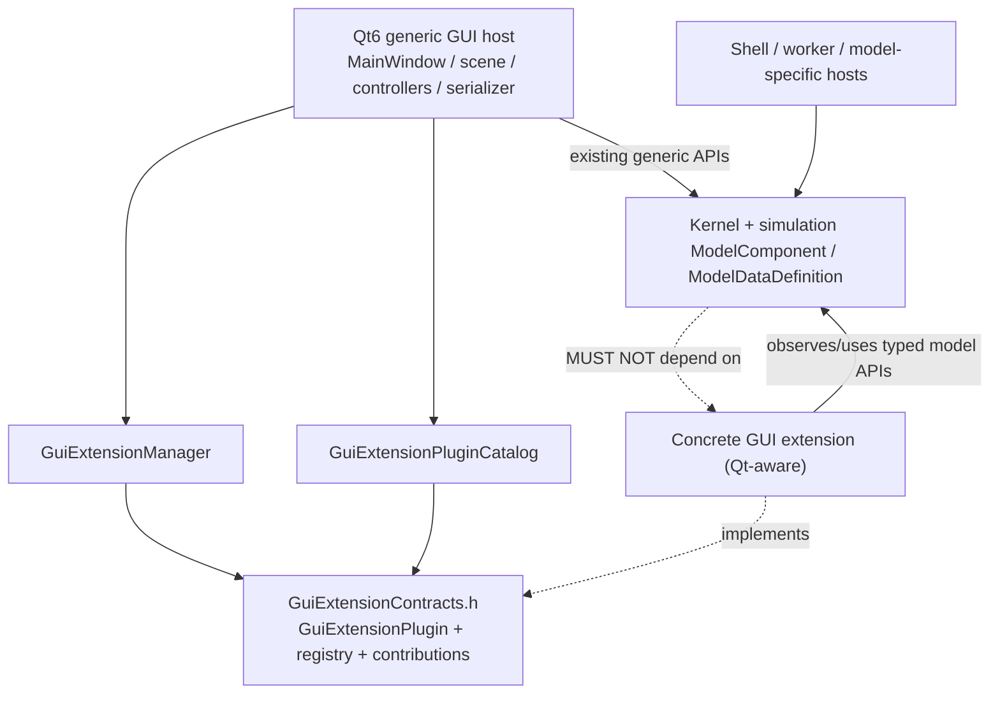

---
document_type: architecture-review-proposal
authority: informative-proposal-not-approved
owner: project-maintainer
status: human-review-required
date: 2026-11-16
source_branch: WorkInProgress
source_commit: 6d1c4be0b385ab7b07ea4d995e2e105fb4d7ee03
tracks: HUM-ARCH-004,HUM-ARCH-006,AUTO-GUI-003,AUTO-GUI-004
---

# GenESyS: formal architectural review of graphical extensions (post-E0–E5)

> **REVIEW DRAFT, NOT IMPLEMENTED API.** This document distinguishes **OBSERVED** C++ signatures in the pinned source commit, **DOCUMENTED** already-approved invariants, **PROPOSED** future contracts, and **DECISION REQUIRED**. Nothing in the proposed method catalogue is a declaration that those methods already exist. This draft does not change C++, persistence, build, branch promotion, or approval status of AUTO-GUI-003.

## 1. Scope, baseline, evidence and architectural objective

Source of truth: the repository `rlcancian/Genesys-Simulator` at `WorkInProgress` commit `6d1c4be0b385ab7b07ea4d995e2e105fb4d7ee03` (2026-11-16). Mandatory documents inspected: `README.md`, `docs/ai_assistants/README.md`, `GOVERNANCE.md`, `ARCHITECTURE.md`, `STATUS.md`, both backlogs, `reference/GUI_EXTENSIONS_ARCHITECTURE.md`, `reference/GUI_EXTENSIONS_IMPLEMENTATION_PLAN.md`, `reference/GUI_EXTENSIONS_EXTRACTION_PLAN.md` and the E0–E5 closeout evidence. Code inspected: `GuiExtensionContracts.h`, `GuiExtensionManager.{h,cpp}`, `GuiExtensionPluginCatalog.{h,cpp}`, all **24 concrete graphical-extension plugin implementation files** under `extensions/` and `extensions/plugins/`, `GraphicalModelSerializer.{h,cpp}`, `SimulationEventController.{h,cpp}`, `ModelGraphicsScene.h`, `AnimationPlaceholder.h`, `Plugin.h`, `PluginInformation.h`, `PluginManager.h` and GUI CMake.

The extraction E0–E5 is merged via [PR #579](https://github.com/rlcancian/Genesys-Simulator/pull/579) at `d9b7c077bc5b33ff2cde0e01718a90cd16431219`. Conceptual architecture was documented via [PR #574](https://github.com/rlcancian/Genesys-Simulator/pull/574). [PR #575](https://github.com/rlcancian/Genesys-Simulator/pull/575) is superseded as an execution vehicle. `STATUS.md` and `AUTO-GUI-004` retain stale “draft/unmerged” wording; GitHub PR state establishes the actual merge. The current `AUTO-GUI-003` remains `blocked-dependency`, and this document requests human architectural review, **not source implementation**.

**Objective:** optional graphical extensions can contribute capabilities to the main Qt6 GUI without requiring plugin-type-specific edits in generic host code. Kernel/parser/model plugins and shell/worker stay independent of GUI/Qt. Keep the current **single plugin interface + composition of contributions**, static registration for this phase, and a separate future dynamic-loading/ABI project.

## 2. Architectural layering and dependency direction



The last dashed connection is a **prohibition**, not an executable dependency. `Plugin` / `PluginInformation` / `PluginManager` in `source/kernel/simulator` represent *simulation-plugin registration/creation*; they are **not parent classes of graphical extensions**. A graphical extension may use a model plugin's public C++ types within its implementation; this is a compile/link dependency of that GUI extension, not a transfer of kernel ownership or a declaration that the model contains an instance of the plugin.

### 2.1 Current inheritance graph — directly observed

```text
GuiExtensionPlugin  [pure abstract class, non-QObject]
├── CoreGuiExtensionPlugin                         [final]
├── GuiExtensionConfigurationGuiExtensionPlugin    [final]
├── ModelPluginInspectorGuiExtensionPlugin         [final]
├── BacteriaColonyViewerGuiExtensionPlugin         [final]
├── CellularAutomataGuiExtensionPlugin             [final]
├── GeneticCircuitGuiExtensionPlugin               [final]
├── BioNetworkAwareGuiExtensionPlugin              [final]
├── BioNetworkEditorGuiExtensionPlugin             [final]
├── BioNetworkExecutionGuiExtensionPlugin          [final]
├── BioParameterManagerGuiExtensionPlugin          [final]
├── BioReactionKineticsGuiExtensionPlugin          [final]
├── BioReactionStoichiometryGuiExtensionPlugin     [final]
├── BioSBMLInteroperabilityGuiExtensionPlugin      [final]
├── BioSimulationResultsGuiExtensionPlugin         [final]
├── BioSpeciesManagerGuiExtensionPlugin            [final]
├── BioReactionContextMenuGuiExtensionPlugin       [final]
├── ColoredPetriNetGuiExtensionPlugin              [final]
├── DecideGuiExtensionPlugin                       [final]
├── DiscreteProcessingVisualizationGuiExtensionPlugin [final]
├── EFSMGuiExtensionPlugin                         [final]
├── GeneticCircuitRenderingGuiExtensionPlugin      [final]
├── GraphNetworkGuiExtensionPlugin                 [final]
├── MarkovChainGuiExtensionPlugin                  [final]
└── ModalModelGuiExtensionPlugin                   [final]

Separate Qt hierarchies, NOT subclasses of GuiExtensionPlugin:
  QGraphicsRectItem -> AnimationPlaceholder ->
      AnimationAttribute | AnimationEntity | AnimationEvent | AnimationExpression |
      AnimationPlot | AnimationQueueDisplay | AnimationResource |
      AnimationStation | AnimationStatistics
  QWidget -> BacteriaColonyCanvas
  QDialog -> BacteriaColonyViewerDialog
  QUndoCommand -> domain-specific editing command subclasses
  QGraphicsScene -> ModelGraphicsScene
```

All 24 concrete graphical plugin classes implement the **same five required overrides**; the optional capabilities are registered by callback-bearing contribution **structures**, not by subclassing multiple “IWhateverPlugin” bases. That is an intentional architectural property to retain.

### 2.2 Current ownership and relationships (not inheritance)

- `GuiExtensionPluginCatalog` has static storage of `const GuiExtensionPlugin*`, registered through `GuiExtensionPluginAutoRegistrar` / `REGISTER_GUI_EXTENSION_PLUGIN(PluginType)`. Observed implementations register static instances, not heap-created instances managed by `PluginManager`.
- `GuiExtensionRegistry` is a **temporary aggregate** constructed at registration/dispatch time; it stores value-type contribution structures with `std::function` callbacks.
- `GuiExtensionManager` owns its applied Qt actions and dock widgets; uses borrowed `QMainWindow*` and plugin pointers. `GuiExtensionPluginCatalog` dispatches diagram, network, visualization and rendering contributions separately, often reconstructing a temporary registry during lookup.
- The model/kernel owns model semantics. The generic Qt scene owns its adopted graphical items according to Qt scene/item rules, subject to command/teardown audits. A graphical extension observes model objects; it must not acquire or delete them by mere activation.
- `GraphicalModelSerializer` manages GUI persistence and currently stores `GuiUnknownDiagramSectionsByModel` for unknown *diagram sections*. This is **not evidence** of arbitrary unknown animation-payload preservation.

## 3. Complete current `GuiExtensionPlugin` interface (OBSERVED)

At `source/applications/gui/genesys/extensions/GuiExtensionContracts.h`:

```cpp
class GuiExtensionPlugin {
public:
    virtual ~GuiExtensionPlugin() = default;
    virtual std::string extensionId() const = 0;
    virtual std::string displayName() const = 0;
    virtual std::string version() const = 0;
    virtual std::vector<std::string> requiredModelPlugins() const = 0;
    virtual void registerContributions(GuiExtensionRegistry* registry) const = 0;
};
```

Every concrete subclass **must implement all five pure virtual methods**. `requiredModelPlugins()` can return an empty list for GUI-only extensions. `registerContributions` may register zero, one or several unrelated capability categories. No required virtual `initialize`, `shutdown`, `onEvent`, `createWidget` or `createAnimation` methods are present today. Do not assert that they exist.

`GuiExtensionRuntimeContext` currently exposes borrowed `Simulator*`, `QMainWindow*`, `Ui::MainWindow*`, `ModelGraphicsView*` and `ModelGraphicsScene*` (nullable). The `Ui::MainWindow*` exposure is a **host-internal coupling** that a future stable extension SDK should avoid; removing it immediately would risk breaking current code.

## 4. Complete current contribution-method catalogue (OBSERVED)

Each row specifies the **full set of callback fields** exposed to implementations. This is the implementable extension surface today, not inheritance.

| Registered type / registry API | Optional callback methods and exact C++ functional signatures |
|---|---|
| `GuiActionContribution` / `addAction` | `isVisible: bool(const GuiExtensionRuntimeContext&)`; `isEnabled: bool(const GuiExtensionRuntimeContext&)`; `trigger: void(const GuiExtensionRuntimeContext&)` |
| `GuiDockContribution` / `addDock` | `isVisible: bool(const GuiExtensionRuntimeContext&)`; `createWidget: QWidget*(const GuiExtensionRuntimeContext&)` |
| `GuiWindowContribution` / `addWindow` | `isVisible: bool(const GuiExtensionRuntimeContext&)`; `open: void(const GuiExtensionRuntimeContext&)` |
| `GuiContextMenuContribution` / `addContextMenu` | `isVisible: bool(const GuiExtensionRuntimeContext&, QGraphicsItem*)`; `populate: void(QMenu*, const GuiExtensionRuntimeContext&, QGraphicsItem*)` |
| `GuiDiagramProjectionContribution` / `addDiagramProjection` | `supports: bool(ModelDataDefinition*)`; `synchronize: void(Simulator*, ModelGraphicsScene*)`; `captureLayout: std::any(Simulator*, ModelDataDefinition*, ModelGraphicsScene*)`; `restoreLayout: void(Simulator*, ModelDataDefinition*, ModelGraphicsScene*, const std::any&)`; `serializeLayouts: QStringList(Simulator*, const GuiDiagramLayouts&)`; `parseLayouts: GuiDiagramLayouts(Model*, const QStringList&)` |
| `GuiNetworkEditorContribution` / `addNetworkEditor` | `supports: bool(ModelDataDefinition*)`; `ownsEditableDataDefinition: bool(ModelDataDefinition*, ModelDataDefinition*)`; `canDeleteElement: bool(ModelDataDefinition*, QGraphicsItem*)`; `createDataDefinitionPropertyCommand: QUndoCommand*(ModelDataDefinition*, ModelDataDefinition*, const std::string&, const std::string&)`; `canStartRelationCreation: bool(ModelDataDefinition*, QGraphicsItem*)`; `createRelationCommand: QUndoCommand*(ModelDataDefinition*, QGraphicsItem*, QGraphicsItem*)`; `elementProperties: std::vector<ElementProperty>(ModelDataDefinition*, QGraphicsItem*)`; `createElementPropertyCommand: QUndoCommand*(ModelDataDefinition*, QGraphicsItem*, const std::string&, const std::string&)`; `acceptsDrop: bool(ModelDataDefinition*, const std::string&, bool)`; `onDataDefinitionDropped: void(ModelDataDefinition*, ModelDataDefinition*)`; `onDataDefinitionRemoved: void(ModelDataDefinition*, ModelDataDefinition*)` |
| `GuiPropertyListContribution` / `addPropertyList` | `supports: bool(ModelDataDefinition*)`; `reconcile: void(ModelDataDefinition*, ModelGraphicsScene*)`; `reconcileMove: bool(ModelDataDefinition*, ModelGraphicsScene*, int, int)` |
| `GuiEditingContextContribution` / `addEditingContext` | `supports: bool(ModelDataDefinition*)`; `resolveOwner: ModelDataDefinition*(ModelDataDefinition*)`; `isNetwork: bool(ModelDataDefinition*)`; `canOpen: bool(Model*, ModelDataDefinition*)` |
| `GuiModelReferenceContribution` / `addModelReference` | `supports: bool(ModelDataDefinition*)`; `currentReference: ModelDataDefinition*(ModelDataDefinition*)`; `resolveChoice: ModelDataDefinition*(ModelDataDefinition*, const std::string&)`; `formatChoice: std::string(ModelDataDefinition*, const std::string&, ModelDataDefinition*)`; `confirmChange: bool(ModelDataDefinition*, ModelDataDefinition*, ModelDataDefinition*, QWidget*)`; `referenceChanged: void(ModelDataDefinition*, ModelDataDefinition*, ModelDataDefinition*, ModelGraphicsScene*, ObjectPropertyBrowser*)`; `propertyChanged: void(ModelDataDefinition*, const std::string&, const std::string&, const std::string&, ModelGraphicsScene*, ObjectPropertyBrowser*)` |
| `GuiComponentVisualizationContribution` / `addComponentVisualization` | `supports: bool(ModelComponent*)`; `configure: void(GraphicalModelComponent*)`; `animateArrival: void(ModelGraphicsScene*, GraphicalModelComponent*, bool)`; `animateDeparture: void(ModelGraphicsScene*, GraphicalModelComponent*)` |
| `GuiDataDefinitionRenderingContribution` / `addDataDefinitionRendering` | `supports: bool(ModelDataDefinition*)`; `configure: void(ModelDataDefinition*, GraphicalModelItemRenderContext*)` |

The declarations above abbreviate the literal `std::function<...>` wrapper but preserve the callback argument and result types in `GuiExtensionContracts.h`. The `GuiNetworkEditorContribution::ElementProperty` value type contains `Kind {String, Boolean, Integer, Double, Enumeration}`, `name`, `value`, `choices`, `kind` and `editable`.

**Metadata fields currently present:** `GuiActionContribution` (id, text, menuPath, toolBarId, statusTip, shortcut); `GuiDockContribution` (id, title, areaHint); `GuiWindowContribution` (id, menuPath, text); `GuiContextMenuContribution` (id); `GuiDiagramProjectionContribution` (id, sectionName); and `id` in each other contribution. Every contribution type has only the callbacks listed above; no additional hidden virtual methods are implied.

### 4.1 The exact registry methods currently available

```cpp
void addAction(GuiActionContribution);
void addDock(GuiDockContribution);
void addWindow(GuiWindowContribution);
void addContextMenu(GuiContextMenuContribution);
void addDiagramProjection(GuiDiagramProjectionContribution);
void addNetworkEditor(GuiNetworkEditorContribution);
void addPropertyList(GuiPropertyListContribution);
void addEditingContext(GuiEditingContextContribution);
void addModelReference(GuiModelReferenceContribution);
void addComponentVisualization(GuiComponentVisualizationContribution);
void addDataDefinitionRendering(GuiDataDefinitionRenderingContribution);
```

The registry also exposes matching `actions()`, `docks()`, `windows()`, `contextMenus()`, `diagramProjections()`, `networkEditors()`, `propertyLists()`, `editingContexts()`, `modelReferences()`, `componentVisualizations()` and `dataDefinitionRenderings()` **const-vector accessors**, plus `clear()`. These are host/registry methods, not methods a plugin subclass overrides.

### 4.2 Host-dispatch methods (OBSERVED, not additional plugin overrides)

`GuiExtensionManager` offers `setPlugins`, `setLoadedModelPluginIds`, `rebuild`, `refreshActionStates`, `populateContextMenu`, `reconcilePropertyListChange`, `reconcilePropertyListMove`, `hasEditingContext`, `resolveEditingContextOwner`, `isNetworkEditingContext`, `canOpenEditingContext`, `currentModelReference`, `resolveModelReferenceChoice`, `formatModelReferenceChoice`, `confirmModelReferenceChange`, `notifyModelReferenceChanged`, `notifyModelPropertyChanged` and `clear`.

`GuiExtensionPluginCatalog` offers `plugins`, `resolvedPlugins`, `presentationMetadata`, `registerPlugin`, `diagramProjectionContributions`, `ownsEditableNetworkDataDefinition`, `hasNetworkEditor`, `hasEditingContext`, `canDeleteNetworkElement`, `createNetworkDataDefinitionPropertyCommand`, `canStartNetworkRelationCreation`, `createNetworkRelationCommand`, `networkElementProperties`, `createNetworkElementPropertyCommand`, `acceptsNetworkEditorDrop`, `notifyNetworkEditorDataDefinitionDrop`, `notifyNetworkEditorDataDefinitionRemoved`, `synchronizeDiagramProjections`, `synchronizeDiagramProjectionsOnSceneThread`, `restoreDiagramProjections`, `configureComponentVisualization`, `animateComponentArrival`, `animateComponentDeparture` and `configureDataDefinitionRendering`. Their exact declarations are in `GuiExtensionPluginCatalog.h`; they are host-facing helpers, not virtual plugin methods.

The catalogue filters configured `enabled`/`disabled` IDs and uses `order`/presentation settings; `GuiExtensionManager::_isPluginDependenciesSatisfied` requires **every** value returned from `requiredModelPlugins()` (AND) to occur in its loaded-model-ID set after normalization. The catalogue itself routes contributions from `resolvedPlugins()`; it does not use the same dependency check in its dispatch path. This difference deserves explicit integration tests before designing a new resolver.

## 5. Complete concrete graphical-extension inventory (OBSERVED)

All rows are **direct final subclasses of `GuiExtensionPlugin`**. Dependency values below are the literal return values of `requiredModelPlugins()`. Contribution columns describe registry calls in the implementation, not intended future features.

| Concrete class (file stem) | Required model plugin IDs | Currently registered capabilities |
|---|---|---|
| `CoreGuiExtensionPlugin` | — | None |
| `GuiExtensionConfigurationGuiExtensionPlugin` | — | Window |
| `ModelPluginInspectorGuiExtensionPlugin` | — | Window |
| `BacteriaColonyViewerGuiExtensionPlugin` | `bacteriacolony` | Action + window (existing viewer, not an in-scene animation tool) |
| `CellularAutomataGuiExtensionPlugin` | — | Window (existing viewer) |
| `GeneticCircuitGuiExtensionPlugin` | `geneticcircuit` | Actions |
| `BioNetworkAwareGuiExtensionPlugin` | `bionetwork` | Action |
| `BioNetworkEditorGuiExtensionPlugin` | `bionetwork` | Window |
| `BioNetworkExecutionGuiExtensionPlugin` | `bionetwork` | Actions |
| `BioParameterManagerGuiExtensionPlugin` | `bioparameter` | Window |
| `BioReactionKineticsGuiExtensionPlugin` | `bioreaction` | Window |
| `BioReactionStoichiometryGuiExtensionPlugin` | `bioreaction` | Window |
| `BioSBMLInteroperabilityGuiExtensionPlugin` | `biosimulatorrunner` | Window |
| `BioSimulationResultsGuiExtensionPlugin` | `bionetwork` | Window |
| `BioSpeciesManagerGuiExtensionPlugin` | `biospecies` | Window |
| `BioReactionContextMenuGuiExtensionPlugin` | `BioReaction`, `BioSpecies` | Context menu |
| `ColoredPetriNetGuiExtensionPlugin` | `ColoredPetriNetNetwork` | Diagram projection, network editor, actions |
| `DecideGuiExtensionPlugin` | `Decide` | Property-list reconciliation |
| `DiscreteProcessingVisualizationGuiExtensionPlugin` | `Queue`, `PickStation` | Component visualization |
| `EFSMGuiExtensionPlugin` | `ModalModel` | Diagram projection, network editor, context menu, actions |
| `GeneticCircuitRenderingGuiExtensionPlugin` | `geneticcircuit` | Data-definition rendering |
| `GraphNetworkGuiExtensionPlugin` | `GraphNetwork` | Diagram projection, network editor, actions |
| `MarkovChainGuiExtensionPlugin` | `MarkovChainNetwork` | Diagram projection, network editor, actions |
| `ModalModelGuiExtensionPlugin` | — | Editing context, model reference |

Source paths are `source/applications/gui/genesys/extensions/<Class>.cpp` for the first 15 rows; domain classes are under `extensions/plugins/{biochemical,cpn,decide,discrete_processing,efsm,genetic,graph,markov,modal}/`.

**Interpretation/risks, not yet proven bugs:**
1. The pair `{"Queue","PickStation"}` has **AND** meaning in the GUI manager. If only one is loaded, the entire extension is unavailable through that manager, although a domain-specific operation might only need one. Evaluate a required **any-of** or per-contribution scope explicitly, rather than silently changing semantics.
2. The pair `{"BioReaction","BioSpecies"}` is also AND; this may be correct for the reaction-link menu. Confirm with the relevant fixture.
3. `EFSMGuiExtensionPlugin` declares `ModalModel`, while its work concerns an EFSM Network; verify against actual registered model plugin identifiers and check how the catalogue bypasses dependency gating.
4. `ModalModelGuiExtensionPlugin` declares no model plugin dependency but uses runtime type checks, which may be acceptable: *conditional applicability* differs from *package activation requirement*.
5. `CellularAutomataGuiExtensionPlugin` is presently a GUI-only viewer in terms of declared dependency; a future in-scene version must declare its actual requirements based on verified model APIs.
6. `GuiExtensionPluginCatalog::registerPlugin` deduplicates pointer identity but no explicit duplicate-`extensionId` rejection was identified there; collision semantics and priorities must be tested. Multiple contributions are currently selected by traversal/first-match in several categories.

## 6. Post-extraction coverage and remaining host-specific coupling

**E0–E5 complete**, evidence in `reference/GUI_EXTENSIONS_EXTRACTION_PLAN.md` and the PR #579 closeout:
- BioReaction/BioSpecies menus -> biochemical context menu contribution.
- Decide Conditions/ports synchronization -> Decide property-list contribution.
- ModalModel, EFSM, Graph, Markov, CPN editing contexts, projections and Property Editor delegation -> registered extension contributions.
- Queue/PickStation runtime overlays -> discrete-processing component-visualization contribution.
- GeneticCircuit glyphs -> data-definition rendering contribution.

**Remaining observed coupling:**
- `GraphicalModelComponent.cpp` includes `plugins/components/Decisions/Decide.h` and contains concrete `dynamic_cast<Decide*>` logic for initial semantic-port shape.
- `SceneToolController::onActionAnimateQueueTriggered()` still activates `ModelGraphicsScene::drawingQueue`; `ModelGraphicsScene.cpp` creates an `AnimationQueueDisplay` drawing placeholder.
- `AnimationPlaceholder` and `GraphicalModelSerializer` still encode several concrete animation types in the generic GUI host. No generic registered animation factory/persistence contract was found in `GuiExtensionContracts.h`.

These are **bounded future extraction opportunities**, not grounds to undo the validated E0–E5 refactor.

## 7. Proposed hierarchy and extension-facing contract model (PROPOSED)

**Preserve `GuiExtensionPlugin` as the sole mandatory abstract superclass.** Its five existing methods remain unchanged in the first compatibility slice. Do **not** introduce compulsory abstract subclasses such as `IAnimationPlugin`, `INetworkEditorPlugin`, `IRendererPlugin`, `IWindowPlugin` or `IServicePlugin`. Each plugin composes zero or more *contribution descriptors* registered through the existing registry.

```text
[GUI PLUGIN ENTRY POINT]
 GuiExtensionPlugin (mandatory: existing five methods)
    |
    +-- concrete FooGuiExtensionPlugin : GuiExtensionPlugin  [direct, often final]
          |
          +-- registerContributions(registry)
                |
                +-- addAction / addDock / addWindow                 [existing]
                +-- addContextMenu                                  [existing]
                +-- addDiagramProjection / addNetworkEditor         [existing]
                +-- addPropertyList / addEditingContext             [existing]
                +-- addModelReference                                [existing]
                +-- addComponentVisualization                       [existing]
                +-- addDataDefinitionRendering                      [existing]
                +-- addAnimationTool                                 [PROPOSED]
                +-- addSimulationObserver                            [PROPOSED, if needed]
                +-- addComponentRenderer                             [PROPOSED]
                +-- addServiceProvider                               [PROPOSED]
          |
          +-- optional extension metadata/dependencies              [PROPOSED]
```

These proposed `add...` method names are **candidate API names, not current symbols**. Implementations should introduce each category only after an exemplar establishes the need. Existing special-purpose contributions should not be replaced unless there is a demonstrated duplication or semantic problem.

### 7.1 Proposed extension metadata / dependency contract

A **candidate** additive descriptor (exact types/names require approval and compilation validation):

```cpp
// PROPOSAL ONLY: these declarations do not exist in WorkInProgress.
enum class GuiDependencyKind { ModelPlugin, GuiExtension, SystemCapability };
enum class GuiDependencyRequirement { Required, Optional };
struct GuiExtensionDependency {
    GuiDependencyKind kind;
    std::string id;
    GuiDependencyRequirement requirement;
    std::string versionConstraint; // to be specified; no parser is authorized
};
struct GuiExtensionDescriptor {
    std::string id, name, version;
    std::vector<GuiExtensionDependency> dependencies;
};
// Candidate future non-pure method, preserving existing requiredModelPlugins():
// virtual GuiExtensionDescriptor descriptor() const;
```

**Decision required:** a metadata method vs an explicit metadata registration function; whether new virtual dispatch is justified; AND/OR dependency grouping; version constraints; whether disabled optional dependencies simply remove particular contributions. Existing `requiredModelPlugins()` must remain a compatibility source until a verified migration. No automatic installation, no execution of external commands from metadata and no model instance creation as a consequence of enabling a GUI extension.

### 7.2 Proposed addAnimationTool — in-scene visual item, independent of model plugins

**Candidate descriptor:** `id`; `extensionId`; `displayName`; `icon`; `menu/toolbar placement`; `supported scene contexts`; optional target-type key; `enabled(context)`; `create(context)`; `configure(item,context)`; `capture(item)`; `restore(context,record)`. A dedicated item instance ID and schema version are required for persistence.

**Candidate callbacks** (types below are design types, not actual repo classes):
- `bool isEnabled(const GuiAnimationContext&)`
- `std::unique_ptr<QGraphicsItem> createItem(const GuiAnimationCreateContext&)`
- `bool configureItem(QGraphicsItem&, const GuiAnimationContext&)`
- `GuiAnimationPayload capturePayload(const QGraphicsItem&)`
- `std::unique_ptr<QGraphicsItem> restoreItem(const GuiAnimationRestoreContext&)`

Scene ownership is transferred **once** upon successful insertion. A produced `unique_ptr` owns the new item before adoption; after explicit adoption the scene/Qt item ownership policy applies. No retained pointer after deletion; undo/redo re-creation and saved identity must be specified. `AnimationPlaceholder` is a possible adapter, **not a required superclass**. A GUI-only animation with no model target is valid.

### 7.3 Proposed addSimulationObserver — event/snapshot flow

Prefer reusing the existing `SimulationEventController`/`OnEventManager` bridge and a **GUI-thread delivered snapshot** over direct long-lived kernel callback registrations in each item. Define immutable event data with model/replication IDs, a monotonic ordering key, simulation time, event type and required state at a declared pre/post-event boundary; do not retain bare `SimulationEvent*` outside its synchronous lifetime.

**Candidate callbacks:**
- `void onAttached(const GuiObservationContext&)`
- `void onSimulationStarted(const GuiSimulationSnapshot&)`
- `void onReplicationStarted(const GuiSimulationSnapshot&)`
- `void onEvent(const GuiSimulationSnapshot&)`
- `void onReplicationEnded(const GuiSimulationSnapshot&)`
- `void onSimulationEnded(const GuiSimulationSnapshot&)`
- `void onDetached()`

These can be optional members of one `GuiSimulationObserverContribution` or a smaller event-handler table, not methods forcibly added to `GuiExtensionPlugin`. Decide whether events are lossless transitions or coalescible snapshots **per observer**; never silently downsample state transitions. Reset/cancel/drain on model close and scene destruction. Qt UI access only from the GUI thread.

### 7.4 Proposed component renderer

Current `GuiDataDefinitionRenderingContribution` configures a domain-specific glyph/render context; it is not yet a replaceable **component renderer provider**. A candidate `GuiComponentRendererContribution` has stable `id`, target plugin type/style, `supports(component,renderContext)`, `createRenderer(component,renderContext)` and optional `refreshRenderer(item,snapshot)`. Use a generic host fallback if absent or disabled. Provider selection must be explicit and stable; do not choose an arbitrary first registration.

### 7.5 Proposed GUI service provider

A candidate `GuiServiceProviderContribution` describes `serviceId`, `providerId`, display metadata, eligibility and a typed service factory (e.g. reports, plots or Expression Builder). **Do not standardize an untyped `void*` or global `MainWindow` override API.** Actual method set must be separately specified for each service category, from a real use case; use a default provider, explicit selection and deterministic fallback. Avoid a generic “replace any widget/action” mechanism.

### 7.6 Persistence contract: common envelope + opaque extension payload

**PROPOSED** persistent record fields:
- `formatVersion`, `extensionId`, `animationTypeId`, `payloadSchemaVersion`;
- stable `itemId`, optional stable `targetKind` + `targetId` + scoped model identity;
- geometry/appearance/z-order/visibility and membership where supported;
- **byte-preserving opaque payload** (including unknown fields) when the implementation is unavailable.

Accepted critical round-trip: **extension present -> save -> extension absent -> load -> save (default Preserve) -> extension restored -> load** must recover payload, target binding and placement. Discard requires explicit user confirmation. A missing graphical extension must not be conflated with a missing model-plugin type needed to deserialize the *simulation model*. Do not replace established `.gui` format unilaterally; first characterize current records and migration fixtures.

### 7.7 Registration, selection and lifecycle (PROPOSED contract)

```text
Static discovery -> normalized IDs -> duplicate/conflict checks -> dependency resolution
-> enabled/disabled eligibility -> contribution registration -> host activation
-> scene/GUI instance creation -> event observation / persistence
-> detach subscriptions -> destroy items/docks/actions -> extension deactivation
```

Required invariants: deterministic registration; missing required dependency disables only its dependent extension/capability and produces diagnostics; optional dependency absence is nonfatal; cycles diagnosed; extension does not own the model plugin; GUI host never assumes an extension is present. For this static phase deactivation must be evaluated with all live GUI callback/item lifetimes; dynamic unloading is **not** available.

## 8. Formal dependency taxonomy and proposed resolution rules

| Edge | Example | Build/activation relation | Ownership |
|---|---|---|---|
| `ConcreteGuiExtension -> GuiExtensionPlugin` | all 24 classes | C++ public inheritance; required | none |
| `ConcreteGuiExtension -> GuiExtensionRegistry` | `registerContributions` | compile-time interface, temporary registry | borrowed |
| `ConcreteGuiExtension -> Model plugin API` | Queue/Decide/Graph etc. | implementation may include specific model headers; requirement declared separately | borrowed model instances |
| `ConcreteGuiExtension -> another GUI extension` | future composition | **not currently declared** as typed dependency | no implicit ownership |
| `ConcreteGuiExtension -> system capability` | future optional Qt/lib capability | **not currently declared** as typed dependency | no auto-install |
| `GUI host -> generic contracts` | Manager/Catalog | generic application dependency | host-managed |
| `GUI host -> concrete optional domain class` | remaining Decide/Queue cases | **technical debt to eliminate incrementally** | N/A |
| `Kernel -> GUI extension` | prohibited | **must never occur** | N/A |

**Specific scenario decision matrix:**
1. Model plugin *installed/registered* vs model instance *present*: these are different predicates. `requiredModelPlugins` currently checks loaded IDs, not presence of an object in a particular model.
2. Multiple independent requirements: current interpretation is AND. New ANY-OF/group/conditional semantics must be explicit, not derived from return ordering.
3. GUI-only extension: empty model dependencies valid; capability may still be disabled without model/scene.
4. Optional system dependency: diagnostic capability check only; no privileged installation, no shell execution.
5. Competing contributions: stable unique contribution IDs; distinguish **additive** actions from **exclusive** renderers/services. Exclusive selection must be explicit and deterministic, with generic fallback.
6. Model switch: eligibility, target binding, pointer validity and subscriptions must be recalculated without changing the model data.
7. Nested networks: formalism-specific editor callbacks remain composition; process connections and Network topology are independent.
8. Static C++ interfaces are **not ABI-stable dynamic plugin contracts**; future dynamic packages require a separate approved design consistent with the versioned opaque-handle C ABI boundary.

## 9. Ownership/lifetime and thread-safety review matrix

| Entity | Current owner or observer | Contract to preserve/validate |
|---|---|---|
| Static `GuiExtensionPlugin` instance | static lifetime, catalogue stores `const*` | nonowning registration; no duplicate IDs; never delete through catalogue |
| `GuiExtensionRegistry` / callback values | stack-local temporary or manager copies | no references to expired locals/scene/model in captured closures |
| `QAction`/`QDockWidget` created via manager | Qt host/manager (`clear` deletes) | teardown once; no stale action slots |
| Windows and custom widgets | Qt ownership depends on creation/parent path | explicit creation/closing/parent contract; no dangling callback |
| `QGraphicsItem` / overlays | generic `QGraphicsScene` after adoption; extension may configure | no double deletion; undo/redo and scene reload validated |
| `QUndoCommand*` created by network extensions | ownership transferred to Qt undo stack on push | document transfer and invalid-target handling; no retained freed target |
| ModelComponent / ModelDataDefinition | model/kernel | GUI observes, never deletes merely because extension is disabled |
| Simulation observer state | proposed central GUI bridge | unsubscribed on destroy; GUI-thread delivery; event queue drained |
| Opaque saved graphical records | serializer/model GUI storage | preserve unknown bytes, IDs and fields across absence/reload |

A complete static-first acceptance path must test teardown/rapid model switch, undo/redo, missing extension, duplicate provider, bad model reference and ideally focused ASan/UBSan/LSan. Source review alone does not establish leak freedom.

## 10. Decision log for maintainer review — no choices silently implemented

| ID | Architectural decision | Proposed default for review | Status |
|---|---|---|---|
| D1 | One base interface vs subclasses per GUI capability | Keep **one** `GuiExtensionPlugin`, compose contribution structures; no mandatory subinterfaces | Proposed |
| D2 | Which extension categories need a new contract? | `AnimationTool` first; event observers only as warranted; renderer/provider from real second examples | Proposed |
| D3 | Dependency metadata API form | Extend compatibly; retain `requiredModelPlugins`; define typed optional/required dependencies and group semantics | Open |
| D4 | AND vs ANY-OF model plugin dependencies | Explicit grouping, evaluate Queue/PickStation and BioReaction/BioSpecies | Open |
| D5 | Per-plugin vs per-contribution dependencies | Prefer per-plugin baseline plus contribution-specific optional gating only when needed | Open |
| D6 | Exclusive renderer/service provider selection | Explicit ID, deterministic selection, fallback to generic host | Proposed |
| D7 | Drawing tool return/ownership and lifetime | Scene adopts explicitly; no compulsory `AnimationPlaceholder` inheritance | Proposed |
| D8 | GUI simulation event contract | Immutable snapshot, ordering/thread affinity, lossless vs coalescible modes | Open |
| D9 | Unknown graphical record retention | Opaque lossless preservation by default; explicit discard | Previously approved invariant; implementation pending |
| D10 | Expose `Ui::MainWindow*` to external contributions | Avoid in future SDK via bounded capabilities; do not break legacy immediately | Open migration |
| D11 | Namespace and ID conventions | Preserve current identifiers; require stable, normalized new IDs and collision tests | Proposed |
| D12 | Dynamic loading / C ABI / Qt ABI | **Separate future decision**, not part of this review or G0–G7 static implementation | Deferred |

## 11. Proposed incremental implementation sequence (no authorization implied)

- **F0 (this review):** complete current-code method, inheritance and dependency inventory; human review of D1–D12; reconcile stale `STATUS.md`/backlog statements in a later approved documentation update.
- **F1:** unify catalogue/manager dependency eligibility and ID-collision diagnostics without changing source-level plugin registration. Build focused tests for dependency edge cases.
- **F2:** minimal `AnimationTool` descriptor/scene factory for one independent *static* exemplar. Add menu/toolbar and scene item without generic-host domain branches; test insert/delete/undo/resize.
- **F3:** simulation observation and generic lossless extension persistence; validate event ordering, missing extension, save/reload/reinstall and cancellation.
- **F4:** migrate remaining Decide/Queue and later Resource/Station; add BacteriaColony/CellularAutomata scene visualizations and service-provider/renderers by separate bounded PRs. Finish manuals and hosted/local validation.

Stop if a proposed interface requires kernel→Qt dependency, undocumented model mutation, unsafe pointer ownership, unapproved persistence migration, or dynamic package/ABI choices. Do not merge an implementation PR without mandated tests.

## 12. Acceptance criteria for THIS review draft

- **PASS (documentation inspection):** exact existing five pure virtual methods and 11 registry categories inventoried; full set of callback names/signatures; all 24 concrete plugin subclasses, declared model dependencies and registered capabilities; current host helpers, known coupling and existing ownership model documented.
- **PASS (design separation):** every new candidate is labelled PROPOSED/OPEN and is not represented as implemented.
- **UNKNOWN (requires future implementation/tests):** feasibility of proposed factories/provider APIs, collision and dependency-policy coverage, Qt GUI end-to-end interaction, cross-extension events, lossless opaque persistence, dynamic ABI.
- **NOT PERFORMED:** compilation, CTest, Qt interaction, ABI test or actual plugin modification; this is a GitHub-only, documentation-only review branch.
- **Human acceptance required** before updating normative architecture or activating `AUTO-GUI-003` source implementation.

## 13. Provenance / direct source references

- [Existing contracts and exact signatures](https://github.com/rlcancian/Genesys-Simulator/blob/6d1c4be0b385ab7b07ea4d995e2e105fb4d7ee03/source/applications/gui/genesys/extensions/GuiExtensionContracts.h)
- [GuiExtensionManager](https://github.com/rlcancian/Genesys-Simulator/blob/6d1c4be0b385ab7b07ea4d995e2e105fb4d7ee03/source/applications/gui/genesys/extensions/GuiExtensionManager.cpp)
- [GuiExtensionPluginCatalog](https://github.com/rlcancian/Genesys-Simulator/blob/6d1c4be0b385ab7b07ea4d995e2e105fb4d7ee03/source/applications/gui/genesys/extensions/GuiExtensionPluginCatalog.cpp)
- [Current extension classes, catalogue and registration](https://github.com/rlcancian/Genesys-Simulator/tree/6d1c4be0b385ab7b07ea4d995e2e105fb4d7ee03/source/applications/gui/genesys/extensions)
- [GraphicalModelSerializer](https://github.com/rlcancian/Genesys-Simulator/blob/6d1c4be0b385ab7b07ea4d995e2e105fb4d7ee03/source/applications/gui/genesys/services/GraphicalModelSerializer.cpp)
- [SimulationEventController](https://github.com/rlcancian/Genesys-Simulator/blob/6d1c4be0b385ab7b07ea4d995e2e105fb4d7ee03/source/applications/gui/genesys/controllers/SimulationEventController.h)
- [Approved conceptual architecture](GUI_EXTENSIONS_ARCHITECTURE.md); [post-extraction plan](GUI_EXTENSIONS_EXTRACTION_PLAN.md); [G0–G7 plan](GUI_EXTENSIONS_IMPLEMENTATION_PLAN.md); [E0–E5 evidence](../history/evidence/2026/11/2026-11-13_gui_plugin_extraction_closeout.md)
